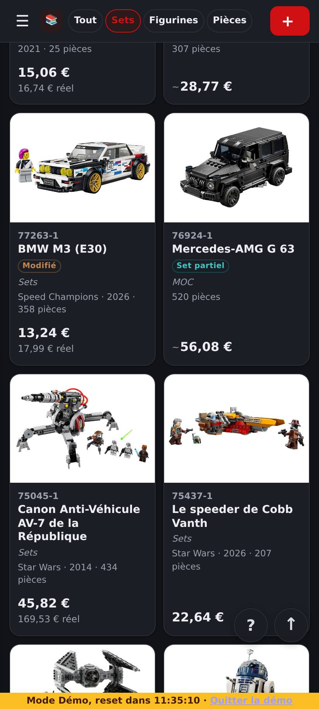
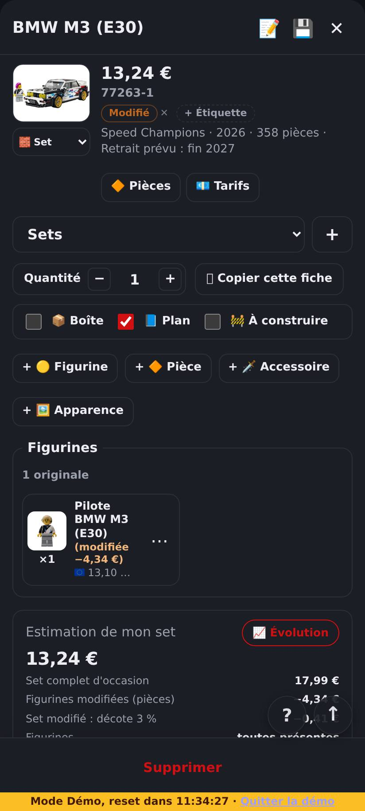
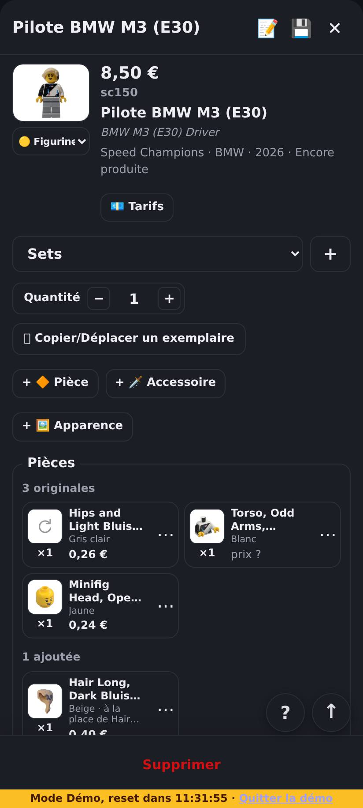
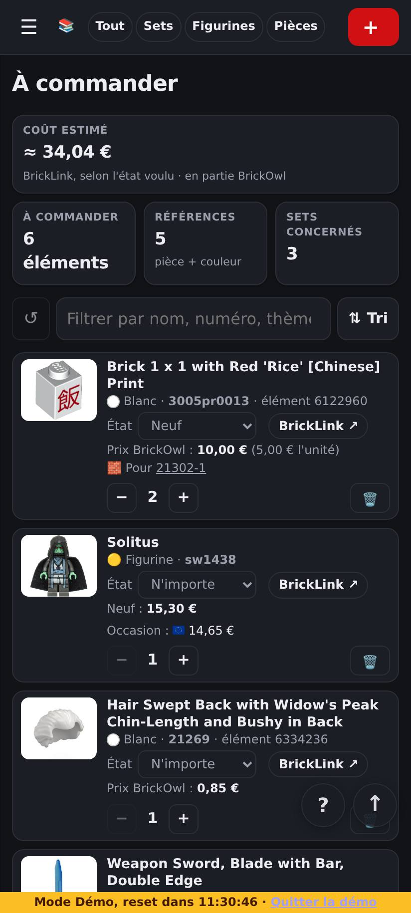
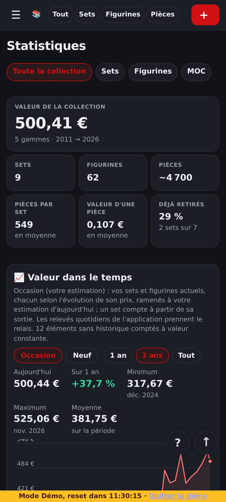
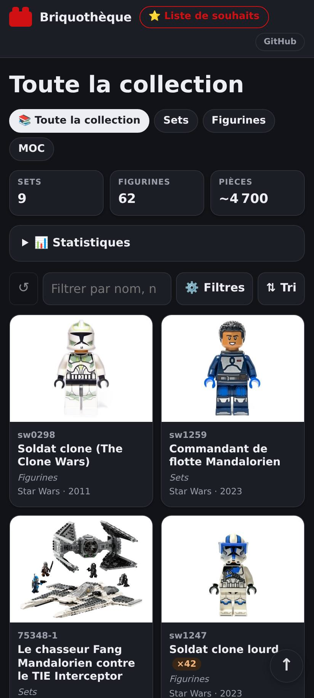

# Briquothèque

Gestionnaire de collection LEGO® orienté **occasion et exploitation** : reconnaissance par photo ou code-barres,
prix BrickLink (France, Europe, monde), sets modifiés et pièces échangées, inventaires pièce par pièce,
commandes BrickLink, liste de souhaits, nouveautés, pages publiques.

Nouveautés de chaque version : [CHANGELOG.md](CHANGELOG.md).

**Source officielle : https://github.com/ClydeHord/briquotheque** — © 2026 Clýde Hørd, tous droits réservés (voir [Licence](#licence)).

**Auteur** : Clýde Hørd (**ClydeHord** sur GitHub), seul auteur et contributeur — voir [AUTHORS.md](AUTHORS.md). Cette mention doit être conservée dans toute copie.

## Aperçu
<p>     </p>

## Philosophie du projet
Déjà, pourquoi ? Tout part de là : j'ai voulu essayer Claude Code, et l'idée m'est venue : gérer ma collection à ma manière. Et tout est allé très vite !

Briquothèque vient de **ma** façon de vivre les LEGO : je les **achète**, je les **monte**, je les **utilise**,
je les **modifie** (pièces échangées, figurines remplacées, sets partiels complétés, MOC), je les **inventorie** et je veux savoir
ce qu'ils valent **vraiment, en l'état** — pas ce que vaudrait une boîte jamais ouverte. Je ne garde jamais rien de scellé. 

La valeur d'occasion d'abord, la décote d'un exemplaire modifié, les figurines manquantes ou ajoutées,
les inventaires pièce par pièce et les pièces à commander pour compléter un set.

**Ce n'est pas un outil de stockage ou d'investissement en boîtes neuves scellées** : il n'est pas pensé pour suivre un stock de neuf.

C'est une philosophie **très personnelle** : l'application répond d'abord à **mes** attentes et n'est pas conçue pour tout le monde.
Elle s'ouvrira peut-être à un public plus large, selon l'intérêt qu'elle suscitera.

## Fonctions
Chaque rubrique est résumée ici ; « Détails » mène à sa description complète, dans [docs/FONCTIONS.md](docs/FONCTIONS.md)
(le guide illustré, dans l'application à l'adresse `/guide-utilisateur`, montre les écrans).

### 📚 Collection et listes
Tout ce que vous possédez, rangé comme vous le voulez : sets, figurines, MOC, sets partiels et pièces, avec leur valeur. → [Détails](docs/FONCTIONS.md#collection-et-listes)
- **Listes et sous-listes** (ex. Star Wars › Grande Armée de la République). Une liste qui a des sous-listes les montre en pastilles en
  haut de la page : la liste entière, chaque sous-liste, et **« Non classées »** (ce qui est rangé directement dans la liste).
- **Couleur de thème** par liste et pour toute l’application (Réglages → 🎨 Thème, « Réinitialiser tous les thèmes ») ; 🎯 couleur prise dans le logo ou une image.
- **Une figurine = une fiche** : ses exemplaires identiques (originales dans les sets, ajoutées, seules) n’ont qu’une carte ; « Dans mes sets » les répartit (sets + seules = quantité, − / + pour sortir ou ranger) ; une pièce changée vaut pour tous les exemplaires identiques ; seul « Dupliquer puis modifier » crée une variante. Pièces d’un lot : « combien en changer ».
- **Téléphone** : le bouton « retour » ramène à la page d’avant ; en descendant, la liste en cours monte dans la barre du haut.
- **Logos des vignettes cliquables** (ouvrent la liste) ; fiches toujours ouvertes en lecture (🔧 pour modifier ; rien n’est enregistré sans 💾, sauf les tâches).
- **Logo et émoji** par liste, et un tableau « Afficher » pour régler, endroit par endroit (menu latéral, barre supérieure, titre, vignettes),
  ce qui se voit : émoji, logo, nom. Sous-listes affichables dans le menu latéral (une à une, ou toutes avec ↳). Une liste qui a des sous-listes choisit
  le logo de ses sous-listes sur les vignettes (le leur, ou le sien). **Logo individuel** d’une fiche : il remplace celui de la liste sur sa vignette.
- **Vues** Tout / Sets / Figurines / Pièces, avec leurs nombres ; la valeur affichée trie du plus cher au moins cher.
- **Barre des filtres** collée en haut en défilant ; tris « Variation de prix (%) » (la plus grosse hausse ou baisse en % d’abord) et « Variation de prix (€) » (le plus gros écart en euros,
  hausse comme baisse) ; **🔃** renverse le tri ; **📈** montre ou cache les variations ; « Définir par défaut » : le tri d’office de la collection (↺ y revient).
- **Vignettes** : le prix en gros tout en bas, le prix à l’unité au-dessus (plusieurs exemplaires) ; plus de ligne « réel ».
- **Filtre** par nom, numéro ou thème ; menu **⚙️ Filtres** (sélection multiple : complet, amélioré, modifié, set partiel, MOC) ; tris ; étiquettes « Set partiel »,
  « Modifié », « Amélioré » (un MOC : « MOC » seul) ; bouton **↺** pour tout remettre à zéro.
- **Sélection multiple** pour déplacer ou supprimer plusieurs fiches ; glisser-déposer sur une liste ou une pastille.
- **🚧 À construire** : les sets pas encore montés, avec leur valeur neuve.
- **‹ Liste parente** : dans une sous-liste, un bouton devant les pastilles ramène à la liste du dessus. Le **logo individuel** d’un set passe à ses figurines rangées dedans (retirable figurine par figurine).

### ➕ Ajout
Retrouver un set ou une figurine en quelques secondes, quelle que soit l'information dont on dispose. → [Détails](docs/FONCTIONS.md#ajout)
- Par **numéro** ou **nom** (français ou anglais), par **photo** (boîte, set monté, pièces), par **code-barres** de la boîte ou
  **code à 7 chiffres** des figurines à collectionner.
- La recherche montre d'abord **ce que vous avez déjà** (« 📚 Dans ma collection », « ⭐ Dans la liste de souhaits »), puis le catalogue.
- **MOC** (création perso) ou **set partiel** : ajout sans recherche, photo scannée pour repérer les pièces, liste de pièces importée
  (XML BrickLink, CSV Rebrickable) ou ajoutée une à une.

### 🗂️ Fiches
Chaque élément a sa fiche, avec tout ce qui le décrit et ce qui le rend unique. → [Détails : fiches](docs/FONCTIONS.md#fiches) · [figurines](docs/FONCTIONS.md#figurines)
- **Sets** : figurines d'origine (quantités, manquantes), figurines ajoutées, **pièces retirées / ajoutées / échangées**, boîte et
  livret, accessoires (mini-constructions), notices LEGO, tâches.
- **Figurines** : chaque figurine, même rangée dans un set, a sa fiche ; elle est comptée **une seule fois** dans la valeur (dans son
  set, ou seule). Elle peut être dans une autre liste que son set ; déplacer un set emmène ses figurines de la même liste.
- **Une figurine, plusieurs exemplaires** : la même figurine seule et dans plusieurs sets = **une seule carte** « ×N » et une seule fiche ;
  « Dans mes sets » règle le nombre dans chaque set (− / +), « Seules (sans set) » le reste.
- **Lots de figurines** : pièces comptées pour toutes les figurines de la fiche (ex. 20 têtes d'origine + 8 autres), estimation réelle,
  sans faire une fiche par figurine.
- **Étiquettes** : celles que l'application calcule (Modifié, Amélioré…), celles que vous posez (**+ Étiquette**), ✕ pour en retirer une.
- **Accessoires** (mini-constructions) : liste de pièces facultative en XML pour une estimation réelle.
- **⧉ Copier cette fiche** (sets, MOC) ; **⧉ Copier/Déplacer un exemplaire** (figurines) : copier, ranger dans un set, déplacer, sortir.
  La copie d'une figurine garde une variante (tête changée…) ; l'application demande si ses exemplaires viennent de l'original
  (« 38 là-bas, 2 ici ») ou s'ils sont en plus.
- **Apparences alternatives** (ex. la DeLorean des trois films) : nommées, défilables en grand, l'une « ⭐ définie comme principale »,
  chacune affichée ou non dans la vue générale.
- Un encart vert signale une **nouvelle fiche** pas encore enregistrée.

### 🖼️ Photos
Des vignettes uniformes et propres, sans logiciel externe : Briquothèque intègre son **outil de détourage, ISNet** (modèle libre
`isnet-general-use`), qui tourne sur votre serveur. → [Détails](docs/FONCTIONS.md#photos)
- **Modifier image** : cadre au format des vignettes, **proposé autour de l'objet** et pouvant **dépasser de la photo** (le surplus
  est blanc) ; rotation libre ; **🖌️ pinceau** blanc pour effacer ce qui gêne (taille réglable, annulation trait par trait).
- **🪄 Détourer le fond** : **ISNet** sur votre serveur (facultatif, voir [Détourage ISNet](#détourage-isnet-facultatif)), sinon
  détourage sur l'appareil ; la photo n'est envoyée à aucun site extérieur.
- Photos du catalogue choisies parmi plusieurs sources, ou vos propres photos (appareil photo, fichier, coller).

### 💶 Prix et estimation
Une valeur réaliste, fondée sur ce qui se vend vraiment. Détails : [Estimation de la valeur](#estimation-de-la-valeur). → [Détails](docs/FONCTIONS.md#prix-et-estimation)
- **Ventes réelles BrickLink des 6 derniers mois** (API officielle), neuf et occasion séparés, par **zones réglables** (par défaut
  France, sinon Europe, sinon monde) ;
  BrickOwl en secours. Le drapeau 🇪🇺 / 🇺🇳 indique la zone d'un prix (France : sans drapeau).
- **Estimation** : boîte, livret, décote d'un exemplaire modifié, figurines manquantes ; **MOC et sets sans cote estimés par leurs
  pièces**.
- **Actualisation** : automatique toutes les X heures (les prix les plus anciens d'abord, dans une limite d'appels par jour) ; une
  fiche ouverte relit ses prix s'ils ont plus de X heures (MOC : ses pièces). Réglable par curseurs (24 h, 2 000 appels, 24 h par défaut).
- **💶 Tarifs** d'une fiche : prix magasin, neuf, occasion, figurines seules, annonces BrickLink cliquables.
- **📈 Évolution** de la valeur de chaque fiche, et de la collection dans les **statistiques**.
- **↑ ↓ ~ à côté des prix** : la variation depuis le dernier relevé ; bouton 📈 pour la montrer ou la cacher dans la vue générale ; toujours affichée
  dans une fiche (prix, estimation, cote, détail des prix). Apparence réglable dans le back office.
- **🔍 Comprendre les variations** (statistiques) : ce qui a fait monter ou baisser la valeur de la liste affichée — ajouts, retraits,
  cotes (la figurine en cause est citée quand un set bouge à cause d'elle), fiches modifiées.
- **Prix solides** : un prix BrickLink fondé sur moins de 3 ventes n'est pas retenu, l'ancien prix est gardé.

### 📋 Inventaires et 🔩 À commander
Vérifier un set pièce par pièce, puis acheter ce qui manque. → [Détails : inventaires](docs/FONCTIONS.md#inventaires) · [à commander](docs/FONCTIONS.md#à-commander)
- **Inventaire** : chaque pièce OK, à commander ou exclue ; remplacer une couleur ; scanner des pièces en photo.
- **À commander** : pièces et figurines à acheter, quantité, état voulu (n'importe, neuf, occasion), prix neuf et occasion, lien vers
  les bonnes annonces BrickLink, coût total, et **export direct vers une *wanted list* BrickLink**.

### ⭐ Souhaits, 👀 À surveiller et ✨ Nouveautés
Ce que vous voulez, et ce qui sort. → [Détails : souhaits](docs/FONCTIONS.md#liste-de-souhaits-et-à-surveiller) · [nouveautés](docs/FONCTIONS.md#nouveautés)
- **Liste de souhaits** : état cherché (neuf, occasion ou les deux, avec ou sans figurines) et le prix correspondant ; lien BrickLink
  à l'état cherché. **À surveiller** : sous-liste privée, avec sa page publique.
- **Nouveautés LEGO** (lego.com) : à venir et sorties récentes, sans ce que vous avez, par thèmes suivis ; photos officielles
  défilables, lien vers lego.com ; **figurines exclusives** avec leur set, ajoutables à la liste de souhaits et, une fois sorties,
  retrouvées sur BrickLink (ou « Pas d'annonces »). La page se relit à l'ouverture. Cases pour réafficher les sets masqués, ceux déjà
  dans la liste de souhaits ou surveillés.
- **Nouveautés relevées toutes les heures** ; ouvrir la page Nouveautés relit lego.com tout de suite. Tris « **Variation de prix (%)** » (la plus grosse hausse ou baisse d’abord) et « **Variation de prix (€)** ».

### 🌐 Pages publiques et partage
Montrer sa collection sans rien risquer. → [Détails](docs/FONCTIONS.md#pages-publiques-et-partage)
- **Pages en lecture seule** : collection, liste de souhaits, À surveiller, nouveautés ; ni prix d'achat, ni notes, ni tâches ;
  **prix de la collection** affichés seulement si vous cochez l'option.
- **Fiches partagées** par lien ; votre nom (« Collection de … ») et votre compte Instagram (facultatif) en haut ; lien vers le projet.
- En défilant, les **listes restent à portée** dans la barre du haut, avec un retour à toute la collection.
- **Démo** publique remise à zéro toutes les 12 h, séparée de votre collection.
- **📤** à côté du titre d’une liste qui a une page publique : partage son lien. **Visites** (une par personne et par jour) dans 📊 Statistiques.

### ✅ Tâches
Ne rien oublier : une pièce à racheter, une couleur à vérifier… → [Détails](docs/FONCTIONS.md#tâches) · [statistiques](docs/FONCTIONS.md#statistiques)
- Par fiche (sur la figurine concernée, même dans un set) ou libres ; rangées par **catégories** (créer, renommer, supprimer).

### ⚙️ Réglages, aide et sécurité
- **Réglages** sur trois colonnes (ordinateur) : prix, estimations, détourage, réseaux sociaux, BrickLink, Rebrickable, pages → [Détails : réglages](docs/FONCTIONS.md#réglages) · [aide, sécurité, mentions légales](docs/FONCTIONS.md#aide-sécurité-et-mentions-légales)
  publiques, sécurité, documentation.
- **Aide** : un « ? » discret à côté de la flèche ↑ explique les boutons de chaque page et fenêtre.
- **Sécurité** : mot de passe pour toute modification, adresses bannies après trop d'échecs, clés API jamais réaffichées.
- **Mentions légales** (lien en bas du menu) : le paragraphe « Éditeur » se modifie (✏️ Éditer).

### 🛠 Back office
L'atelier de l'application, à l'adresse `/backoffice` : **tout se modifie sans écrire de code ni ouvrir de console**. → [Détails](docs/FONCTIONS.md#back-office) · [Notice illustrée (PDF)](docs/briquotheque-backoffice.pdf)
- **Modifier à la souris** : cliquer n'importe quel élément du site pour le renommer, le masquer, le restyler, lui donner une icône ou une image,
  changer son lien ou ce qu'il fait au clic, le décaler ; mode « ✋ Déplacer » pour tout replacer par glisser-déposer ; **clic droit** sur
  un élément : tous ses outils (modifier, masquer, copier / coller le style, couper / coller pour le déplacer, annuler ses modifications).
- **Apparence** (couleurs clair / sombre, logo, police), **boutons et tailles**, **textes**, **étiquettes et pastilles** (renommer, recolorer, masquer,
  afficher sous condition, créer les vôtres), **fiches** (ordre et visibilité des blocs), **champs personnalisés**, liens automatiques, cartes, menu.
- **Pages** : créez vos propres pages par blocs (textes, images, boutons, listes de fiches filtrées, totaux, tableaux) ; une page peut être publique (`/p/…`).
- **Page « Réglages »** réorganisable, **comportements** (page de départ, tri par défaut, raccourcis clavier, action au clic, figurines
  identiques regroupées ou non, flèches de variation, fiches ouvertes directement en modification…), **script libre** (JavaScript de
  l'appli privée, pour qui sait).
- **Avancé** : champs calculés par formules, règles « si… alors », tuiles, vues, tris et filtres ; corrections du catalogue ; tableur CSV.
- **Serveur** : sauvegardes et restauration, état et journal, redémarrage, fichiers de données, paramètres, mots de passe, et même le code
  (vérifié avant écriture, versions gardées, retour arrière automatique, page de secours).
- **Sûr** : brouillon avec aperçu en direct puis « Publier », annulation, historique ; mot de passe à part créé à la première visite ;
  `?bo=off` affiche le site sans personnalisation. Pensé pour ordinateur.
- **🧩 Éléments d’origine** : renommer, masquer, réordonner les tris, filtres et tuiles d’origine ; pourcentages des calculs d’origine modifiables.

### 📴 Sans internet
L'application reste utilisable même si le serveur perd internet. → [Détails](docs/FONCTIONS.md#sans-internet)
- Le serveur garde en local les images de tout ce que vous avez et des nouveautés (chaque image cherchée chez ses sources l'une après
  l'autre) ; la copie locale passe toujours avant le réseau.
- Seules la recherche et l'actualisation des prix demandent internet (le détourage, ISNet ou sur l'appareil,
  s'en passe).
- Application web **installable sur téléphone**, utilisable hors connexion (dernière copie gardée sur l'appareil).

## Estimation de la valeur
Briquothèque n'invente pas de cote : la base est **ce que les acheteurs ont réellement payé**.

**Prix de référence d'un set, d'une figurine ou d'une pièce** — le guide des prix de **BrickLink** (API officielle) :
la **moyenne des ventes des 6 derniers mois** (le « Qty Avg Price » affiché par BrickLink), **neuf et occasion séparément**.
- **Zone** : la **France** s'il y a au moins **3 ventes**, sinon l'**Europe**, sinon le **monde** (à défaut, la zone la plus fournie) ;
  partout, le drapeau de la zone précède le prix (🇪🇺 Europe, 🇺🇳 monde ; sans drapeau : France), avec le nombre de ventes dans le détail.
- **Aucune vente en 6 mois**, nulle part : les **annonces en cours** (prix demandés), signalées comme telles.
- **Pourquoi pas les annonces ?** Ce sont des prix *demandés* : sur les relevés faits, souvent 20 à 150 % au-dessus des ventes
  (ex. une annonce d'occasion à 100 € pour des ventes autour de 30 à 40 €). Sur la plupart des sets comparés, les ventes
  réelles sont proches des estimations des sites spécialisés.
- **Secours** : BrickOwl quand BrickLink ne répond pas (ou sans codes BrickLink) ; prix magasin LEGO pour un set encore inconnu.
- **Fraîcheur** : une passe chaque nuit relit les prix les plus anciens (budget d'appels réglable, sous le quota BrickLink) ;
  une fiche ouverte est relue si son prix a plus de 24 h. L'historique de chaque prix est gardé (📈 Évolution).

**Valeur d'un exemplaire de votre collection** — à partir de ce prix de référence :
- **État** : prix neuf pour un exemplaire neuf, prix d'occasion sinon.
- **Figurines** : chaque figurine est une fiche à part, avec son propre prix, mais **comptée dans la valeur de son set** (jamais deux fois).
  Figurine **manquante** : son prix est déduit ; en **plus** : ajouté ; **sortie du set** : elle devient indépendante et est déduite du set.
  Un set sans ses figurines garde au moins 25 % de sa cote.
- **Pièces échangées** : l'écart de prix des pièces retirées / ajoutées est compté ; un exemplaire **modifié** (pièces d'origine retirées
  ou remplacées) subit une **décote** réglable.
- **Boîte** (set d'occasion) : + le prix d'une boîte vide relevé, sinon un pourcentage réglable. Le livret de plans n'entre pas dans le calcul.
- **MOC, sets partiels, éléments sans cote** : **estimation par les pièces** — la somme des prix de leurs pièces (BrickLink, sinon BrickOwl).

**À commander** — coût d'achat selon l'**état voulu** de chaque ligne : neuf (par défaut), occasion, ou « n'importe » (le neuf
s'il vient de France, même plus cher, sinon le moins cher des deux) ; si le prix voulu manque, l'autre est pris et signalé.


## Installation

### Machine (Linux)
Briquothèque tourne sur un petit serveur Linux (Debian, Ubuntu…, x86-64 ou ARM64), chez vous ou loué.

| | Minimum | Conseillé |
|---|---|---|
| **Processeur** | 1 vCPU | 1 vCPU suffit ; plus de cœurs n'accélèrent **que le détourage ISNet** (8 à 10 s par photo avec 1 vCPU) |
| **Mémoire (RAM)** | 1 Go (sans détourage ISNet) | **2 Go** avec le détourage ISNet : l'application occupe ~300 Mo (+ ~80 Mo pour la démo publique), un détourage ~810 Mo de plus pendant quelques secondes |
| **Logiciels** | Python 3.12 ou plus | + un Python avec `onnxruntime`, `numpy`, `pillow` pour le détourage ISNet (facultatif) |
| **Stockage** | voir ci-dessous | disque SSD conseillé |

**Stockage** : l'application (~30 Mo), le détourage ISNet (~360 Mo, facultatif), puis vos données. Celles-ci grandissent surtout avec
les images gardées en local pour fonctionner sans internet (photos du catalogue, des pièces, des nouveautés), environ **1,2 Mo par fiche**
(mesuré sur une collection de 736 fiches : 895 Mo). Estimations, sauvegardes comprises :

| Fiches (sets, figurines, MOC…) | Données |
|---|---|
| 200 | ~0,3 Go |
| 500 | ~0,7 Go |
| 1 000 | ~1,3 Go |
| 2 000 | ~2,5 Go |
| 5 000 et plus | ~6 Go, puis ~1,2 Go par tranche de 1 000 fiches |

Le **back office** ne demande rien de plus : il n'ajoute aucune tâche de fond (deux petits modules en mémoire, trois scripts légers dans les pages).

Comptez en plus l'espace du système (Linux, Python) ; avec ISNet, ajoutez ~0,4 Go. Les grosses collections de pièces (inventaires
détaillés) prennent un peu plus.

### Application
Prérequis : **Python 3.12 ou plus**, rien d'autre (bibliothèque standard uniquement).

```bash
git clone https://github.com/ClydeHord/briquotheque.git
cd briquotheque
python3 server.py          # puis ouvrir http://localhost:8765
```
Au premier lancement, un **mot de passe initial** est affiché dans la console ; changez-le ensuite dans l'application
(🔒 Réglages › Sécurité, 10 caractères au moins), ou : `python3 server.py --mot-de-passe NOUVEAU`.

Les données sont créées dans `data/` (collection, réglages, photos, sauvegardes). **Ne publiez jamais ce dossier.**

### En service (Linux, systemd)
```ini
[Unit]
Description=Briquothèque
After=network-online.target

[Service]
WorkingDirectory=/chemin/vers/briquotheque
ExecStart=/usr/bin/python3 -u server.py
Restart=on-failure
# derrière un proxy (nginx…) : son adresse, pour connaître l'adresse réelle des visiteurs
Environment=BQ_PROXIES=192.0.2.10
NoNewPrivileges=yes
PrivateTmp=yes

[Install]
WantedBy=multi-user.target
```
Pour un accès depuis Internet, placez Briquothèque derrière un proxy HTTPS (nginx, Caddy…) qui transmet
`X-Real-IP`, `X-Forwarded-For` et `X-Forwarded-Proto`, et déclarez son adresse dans `BQ_PROXIES`.

### Détourage ISNet (facultatif)
Le bouton « 🪄 Détourer le fond » peut utiliser **ISNet** (modèle libre `isnet-general-use`) sur votre serveur : la photo ne part nulle
part. Il faut un Python à part avec `onnxruntime`, `numpy`, `pillow` et le modèle (~180 Mo ; ~810 Mo de mémoire pendant un détourage,
une photo à la fois ; quelques secondes par cœur de processeur). Sans lui, le détourage se fait sur l'appareil (fonds unis).
```bash
mkdir -p ../briquotheque-outils/detourage && cd ../briquotheque-outils/detourage
python3 -m venv venv && venv/bin/pip install onnxruntime numpy pillow
curl -LO https://github.com/danielgatis/rembg/releases/download/v0.0.0/isnet-general-use.onnx
```
Emplacement par défaut : `../briquotheque-outils/detourage` (à côté du dossier de l'application) ; sinon `BQ_CUTOUT_DIR`.

### Configuration
| Variable | Rôle | Défaut |
|---|---|---|
| `HOST`, `PORT` | adresse et port d'écoute | `0.0.0.0`, `8765` |
| `BQ_DATA` | dossier des données | `./data` |
| `BQ_PROXIES` | proxys de confiance (séparés par des virgules) | aucun (seulement la machine elle-même) |
| `BQ_DEMO_SITE` | `1` : démonstration publique `/demo` | désactivée |
| `BQ_CUTOUT_DIR` | dossier du détourage ISNet (`venv/`, modèle) | `../briquotheque-outils/detourage` |

Dans l'application (⚙️ Réglages) : clé API **Rebrickable** (catalogue, inventaires), codes de l'API officielle **BrickLink**
(prix ; adresse IP publique du serveur à déclarer chez BrickLink), zones des prix, estimations, pages publiques.
Les clés restent sur le serveur et ne sont jamais réaffichées.

**Mentions légales** : lien « Mentions légales » en bas du menu ; le bouton **✏️ Éditer** change le paragraphe « Éditeur » (votre nom,
ou celui de la personne pour qui vous gérez le site). Le reste des mentions (logiciel, droits d'auteur, marques, données) est celui
de l'application et ne se modifie pas.

## Premier lancement
- Briquothèque demande de **créer votre mot de passe** (10 caractères au moins), puis vos **clés API Rebrickable et BrickLink**
  (facultatives, avec la marche à suivre et leur utilité). Depuis Internet, un **code d'installation** affiché dans la console
  du serveur (et dans `data/setup_code.txt`) est aussi demandé : personne d'autre ne peut prendre votre installation.
- Une liste **« Exemples »** contient une **fiche de démo** de chaque type (set complet, set avec pièces ajoutées, set avec figurine
  modifiée, set avec figurines ajoutées, set partiel, MOC, figurine MOC, figurine, figurine modifiée) et un **inventaire de démo**,
  marqués d'un bandeau jaune : modifiez-les ou supprimez-les librement.
- Sans clés API, un bandeau rappelle de les fournir : elles donnent les tarifs, les images, la recherche et les inventaires.

- **Back office** (facultatif) : Réglages → 🛠 Back office. À la première visite, il demande de créer **son mot de passe** (à part, ou le même
  que celui de l'application). Ne le perdez pas : il ne se retrouve pas (il faudrait supprimer `data/backoffice_auth.json` sur le serveur).

## Guides
Les guides sont des wikis servis par l'application (une page par chapitre, sommaire, recherche ; imprimer une page imprime le guide entier) :
- `/guide-utilisateur` : guide utilisateur illustré (toutes les fonctions, pas à pas) — Réglages → ❓ Aide ;
- `/backoffice/guide` : notice du back office (exemples, captures, recettes, dépannage) — bouton « ❓ Notice » du back office.
- **🤖 Condensé pour IA** (bouton de chaque guide) : tout le guide en un texte à copier-coller dans une IA, qui répond alors « comment faire » d’après lui.

Ils sont écrits par `python3 docs/build_docs.py` (contenu : `docs/guide_content.py`, `docs/backoffice_content.py` ; moteur : `docs/wiki.py`).

## Licence
© 2026 Clýde Hørd — tous droits réservés. Concept et propriété : Clýde Hørd ; développé avec Claude Code.

Briquothèque est un logiciel **propriétaire**, dont le code est visible mais qui **n'est pas libre**.

- ✅ **Autorisé**, gratuitement : le télécharger depuis **ce dépôt, seule source officielle**, l'**installer chez vous
  (auto-hébergement)** et l'utiliser pour **votre propre collection**, à titre personnel et non commercial ;
  laisser des visiteurs consulter les pages publiques de votre collection.
- ❌ **Interdit** sans autorisation écrite de l'auteur :
  - **toute redistribution**, même gratuite (autre dépôt, miroir, site, archive, paquet, image Docker, appareil préinstallé…) ;
  - **toute commercialisation** (vente, offre payante, usage professionnel, hébergement ou accès proposé à des tiers, publicité) ;
  - modifier le logiciel ou en réutiliser des parties ; l'héberger pour la collection d'autres personnes ;
  - retirer les mentions de propriété, le filigrane ou les métadonnées des photos ; utiliser les noms « Briquothèque » ou « Clýde Hørd » ;
  - utiliser le code, les textes ou les photos pour entraîner une intelligence artificielle.
- 📷 **Photos** : les photos fournies (exemples, captures du guide) sont des œuvres de Clýde Hørd, signées d'un filigrane et de
  métadonnées. Aucune réutilisation hors de l'application, aucune retouche (ni retrait du filigrane ou des métadonnées).

Conditions complètes : fichier [`LICENCE`](LICENCE).
LEGO® est une marque du groupe LEGO, qui ne parraine, n'autorise ni n'approuve ce logiciel.

**Composants tiers** : `static/flags.woff2` — drapeaux de [Twemoji](https://github.com/jdecked/twemoji) (© Twitter, Inc. et contributeurs, licence
[CC-BY 4.0](https://creativecommons.org/licenses/by/4.0/)), via le paquet `country-flag-emoji-polyfill`. Détourage facultatif : modèle
`isnet-general-use` (projet [rembg](https://github.com/danielgatis/rembg)), installé à part, hors de ce dépôt.
